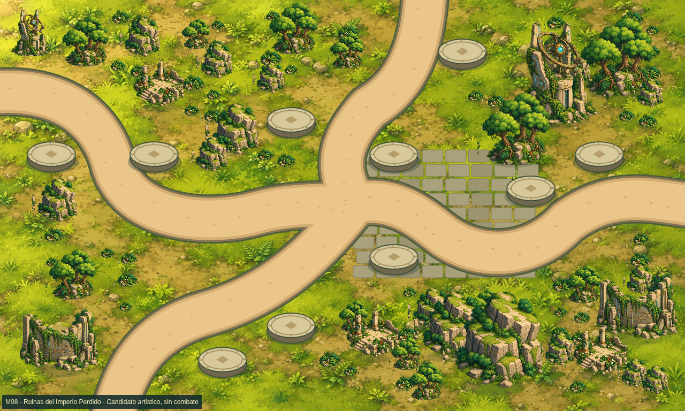
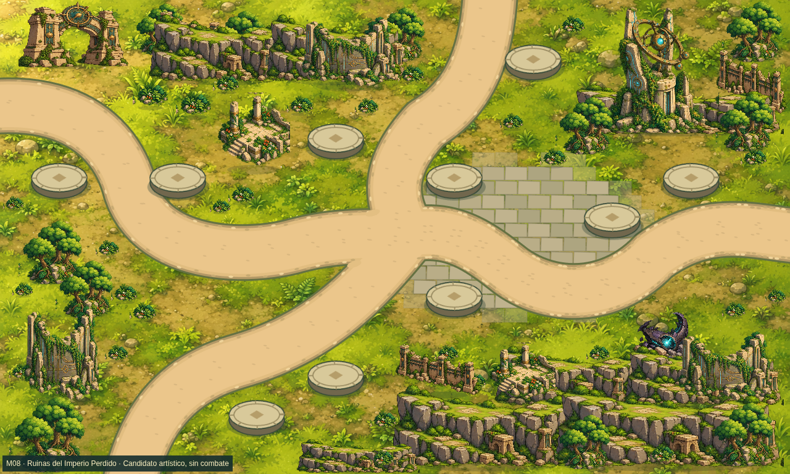
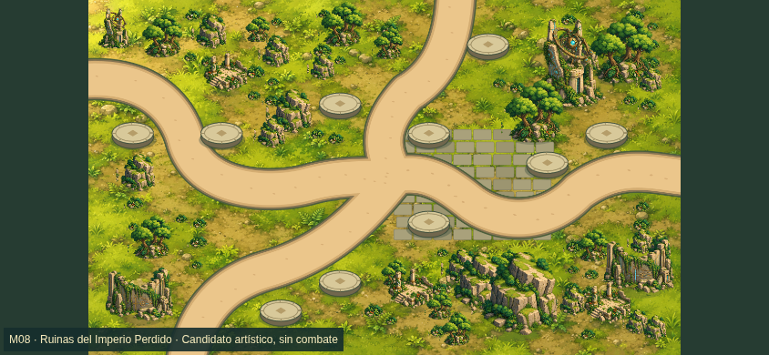
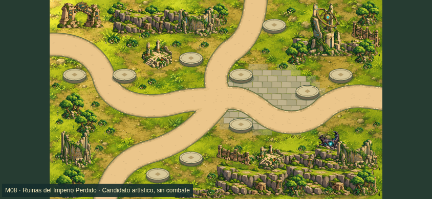

# M08 ART R2 — comparación del render

Misma cámara y perfiles; antes corresponde al arte d754b00, después a m08-observatory-candidate-r2. No son mockups. La aprobación artística sigue pendiente.

| Perfil | Antes | Después |
| --- | --- | --- |
| Escritorio1280×768 |  |  |
| Móvil844×390 |  |  |
| Móvil932×430 DPR2 | [Antes](evidence/before-r2/touch932.png) | [Después](evidence/touch932.png) |
| Overlay | [Antes](evidence/before-r2/desktop-overlay-after.png) | [Después](evidence/desktop-overlay-after.png) |

Revisar agrupación de la ciudad, continuidad de cornisas, encaje de plaza y ruinas, señal alienígena y contraste en móvil. Geometría protegida:151/126/126nodos,10pads. Limitaciones pendientes en ACTA.md.
